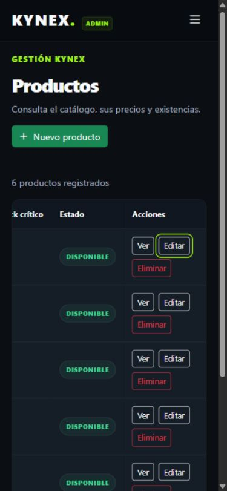

# Auditoría final de KYNEX

Fecha: 26 de octubre de 2026. Rama: `feature/react-migration`.

## Resultado y trazabilidad

- Clon nuevo del repositorio público en `a4c13bc`: `npm ci`, suite con cobertura y build correctos.
- **80 archivos y 597 pruebas aprobadas; 0 fallidas y 0 omitidas.** Duración observada: 150,02 s.
- Cobertura: sentencias 97,91%; ramas 94,66%; funciones 99,30%; líneas 98,98%.
- Corrección visual `55f03c3`: se evita partir las etiquetas de stock de la tabla móvil.
- El contenido JS/JSX y la configuración/dependencias coinciden entre el corte de la suite y el ajuste CSS, normalizando LF/CRLF. El build del ajuste también pasó y se comprobó en navegador.
- ERS 2.1, informe Word de testing y guía de diez pruebas preparados para la entrega.

Los resultados detallados se conservan en [testing-final.json](evidencias/testing-final.json),
[coverage-summary.json](evidencias/coverage-summary.json) y
[rutas-responsive.json](evidencias/rutas-responsive.json).

## Rutas y tamaños revisados

Navegador integrado basado en Chromium, sobre el build servido por `vite preview`.
Se usó un origen de prueba separado de la sesión habitual del estudiante.
Cada combinación registró un `main`, un `h1`, ancho de página sin desbordamiento
horizontal y ausencia de errores en imágenes que habían terminado de cargar.
Esto no afirma que todas las imágenes de carga diferida se descargaran en cada medición.
Las tablas anchas conservan desplazamiento dentro de su contenedor.

| Ruta o variante | 390 × 844 | 768 × 1024 | 1280 × 800 |
| --- | --- | --- | --- |
| `/` | Conforme | Conforme | Conforme |
| `/productos` | Conforme | Conforme | Conforme |
| `/productos/1` | Conforme | Conforme | Conforme |
| `/carrito` | Conforme | Conforme | Conforme |
| `/login` | Conforme | Conforme | Conforme |
| `/registro` | Conforme | Conforme | Conforme |
| `/contacto` | Conforme | Conforme | Conforme |
| `/nosotros` | Conforme | Conforme | Conforme |
| `/blog` | Conforme | Conforme | Conforme |
| `/blog/creatina-y-rendimiento` | Conforme | Conforme | Conforme |
| `/blog/recuperacion-muscular` | Conforme | Conforme | Conforme |
| `/entrenamiento` | Conforme | Conforme | Conforme |
| `/rutina` | Conforme | Conforme | Conforme |
| `/admin` | Conforme | Conforme | Conforme |
| `/admin/usuarios` | Conforme | Conforme | Conforme |
| `/admin/usuarios/nuevo` | Conforme | Conforme | Conforme |
| `/admin/usuarios/1/editar` | Conforme | Conforme | Conforme |
| `/admin/productos` | Conforme | Conforme | Conforme |
| `/admin/productos/nuevo` | Conforme | Conforme | Conforme |
| `/admin/productos/1/editar` | Conforme | Conforme | Conforme |
| `/admin/pedidos` | Conforme | Conforme | Conforme |
| `/admin/pedidos/1001` | Conforme | Conforme | Conforme |

Las 22 variantes representan las **20 pantallas originales**: los formularios de
usuario y producto se revisaron en creación y edición. Las 66 comprobaciones y
capturas apoyan la revisión de estos estados; no son una comparación de cada píxel
con la EP1 ni una matriz de todos los navegadores y estados posibles.

## Recorridos funcionales observados

| Recorrido | Resultado observado |
| --- | --- |
| Catálogo, detalle y carrito | Dos unidades de creatina: $43.980 más $3.990 de despacho. Tres unidades: $65.970 y despacho gratuito. Recarga conserva tres unidades. |
| Continuar compra | Muestra el aviso de checkout futuro y conserva el carrito. La ausencia de solicitudes/escrituras se comprueba además en la suite. |
| Entrenamiento y rutina | Buscar banca, agregar Press de banca, cambiar de cuatro a cinco series y recargar conserva el ajuste. |
| Navegación móvil | Abrir/cerrar menú; seleccionar Carrito cierra el menú y conserva contador. Menú administrativo también revisado. |
| Visita anónima | Acceso directo a usuarios solicita Login. |
| Cliente | Acceso administrativo devuelve a la tienda. |
| Vendedor | Consulta panel y pedidos; no accede a gestión de usuarios ni formulario de producto. |
| Administrador | Consulta todas las rutas de la matriz; formularios disponibles. |
| Producto temporal | Validación de vacíos; alta con stock crítico; edición a disponible; cancelar eliminación conserva el registro; confirmar lo elimina. Catálogo vuelve a seis productos. |
| Contacto | Errores al enviar vacío, foco en Nombre; datos válidos muestran confirmación local. |
| Registro | Errores y foco en RUN al enviar vacío; alta de un usuario de prueba con comuna dependiente y confirmación de contraseña demostrativa inicial. |
| Cambio y cierre de sesión | Conserva tres unidades del carrito y un ejercicio con cinco series en la rutina. |
| Rutas inexistentes | Producto, artículo, página pública, página administrativa y pedido desconocidos presentan estado de error y navegación de regreso. |

Rutas de error comprobadas: `/productos/999999`, `/blog/no-existe`, `/no-existe`,
`/admin/no-existe` y `/admin/pedidos/999999`. La consola de la aplicación no registró
errores ni advertencias durante los recorridos revisados.
La suite complementa estas observaciones con cambios entre pestañas, corrupción
de datos, fallos de almacenamiento, permisos desconocidos y CRUD de usuarios.

## Hallazgo corregido

La etiqueta de stock se dividía en varias líneas en la tabla administrativa móvil.
`src/styles/admin.css` aplica `white-space: nowrap` a `.kynex-stock-badge` dentro
de esa tabla. Se recompiló y comprobó la etiqueta en los seis productos originales,
con una sola línea y sin desbordamiento horizontal de la página.
No cambia reglas, datos ni componentes JavaScript.

## Límites y comprobaciones que dependen del entorno de entrega

- El iframe y el acceso directo de YouTube mostraron que el video original está
  restringido y requiere aprobación, código 151. La reproducción sigue sin validarse
  en este entorno. Comprobarla en el navegador de presentación; conservar el recurso
  original no basta para afirmar reproducción correcta.
- RNF-12 exige Chrome, Edge, Firefox y Safari; esta auditoría usa un solo navegador.
- Los objetivos RNF-01 de 3 s y RNF-02 de 300 ms no tienen una medición específica.
- La accesibilidad cuenta con casos de etiquetas, errores, teclado y foco; no se
  declara una auditoría exhaustiva con tecnologías de asistencia.
- En un alojamiento nuevo debe verificarse el fallback SPA con recargas directas.
  El repositorio y ZIP se entregan para ejecución local; no se publicó un alojamiento nuevo.

El código conserva el alcance académico de EP1: LocalStorage, autenticación
demostrativa, contacto local, pedidos de consulta y checkout informativo.
Back End, pagos y persistencia centralizada siguen siendo evolución futura.
La guía permite preparar la defensa; el estudiante debe ensayarla y presentarla.

## Corrección posterior de imágenes del carrito

El carrito conservaba un ícono fijo aunque el producto tuviera fotografía. Se
reutiliza `ProductImage`, igual que en catálogo y detalle, con miniatura contenida
en su espacio y el respaldo existente ante imágenes ausentes o fallidas.
Se ampliaron las aserciones de CartItem y CartPage para detectar el caso, incluida
la recuperación de una compra guardada solo con id y cantidad: ambas fallaron
antes de corregirlo. Después, `npm test -- ProductImage CartItem CartPage` aprobó
los **9 casos de 3 archivos**, y `npm run build` terminó correctamente.

Se comprobó la fotografía empaquetada de creatina en 1280 × 900 y 390 × 844,
también después de recargar, sin desbordamiento de página ni errores de consola.
No se cambia el formato de almacenamiento ni hace falta vaciar el carrito.
Esta verificación focalizada es posterior al corte de cobertura documentado arriba;
no se volvió a medir la cobertura global para este ajuste.
